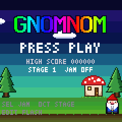
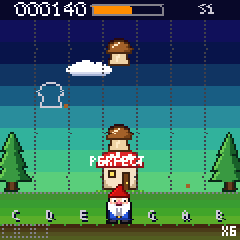
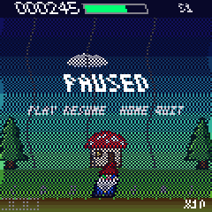
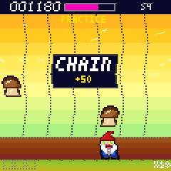
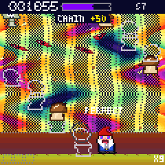
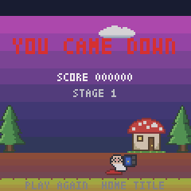

# GNOMNOM

GNOMNOM is a rhythm game for the M-VAVE FM-1. A garden gnome stands on the forest floor while mushrooms fall down
seven lanes; every mushroom is a note of a famous tune, and pressing its lane's key as it reaches his mouth eats
it and plays the note on the synth, so a clean run plays the melody. The band behind him starts as a straight
rendition and turns into house, deep house, acid, rave, breaks, IDM and hard dance stage by stage, and the screen
goes wavy, mirrored and strange along the way. The trip meter is your life: miss and it drops, eat and it climbs,
let it run out and you come down. The white keys are the lanes, the lowest three black keys hold the power-ups
you stash, and the LEDs under the keys show what is coming. MIDI in and out over USB and Bluetooth.

---

## Contents

1. Install
2. The first minute
3. The screen and the lights
4. The controls
5. The lanes, the keys and the registers
6. The mushrooms
7. The stash and the abilities
8. The trip meter, the score and the combo
9. The stages
10. The boss
11. JAM, practice and the demo
12. The knobs
13. MIDI
14. Bluetooth
15. What is saved
16. The simulator and the emulator
17. The screen reader
18. Troubleshooting

---

## 1. Install

**From a terminal:** `python3 base/tools/fm1_install.py app/build/gnomnom.fwsc`, with the FM-1 connected by
USB. Hold OCT− (or OCT− and OCT+ for five seconds) at power-on for update mode.

**From the browser:** in Chrome or Edge, the installer page writes the same package; it can put M-VAVE's own
firmware back too.

Installing is at your own risk. An FM-1 that only shows up as the chip's `WL82 UBOOT1.00` disk is recovered with
felucca-bsp's `fm1_rescue`.

---

## 2. The first minute

1. Power on. The logo comes up over the forest, a music box plays the Mountain King, the gnome idles by the
   toadstool house and PRESS PLAY blinks. The screen says STAGE 1 and JAM OFF.
2. Press PLAY. The screen says STAGE 1, FOREST FLOOR, the band counts the intro in, and the first mushrooms start
   down the lanes. The letters C D E F G A B under the lanes name the white keys that eat them.
3. Watch the key lights. A lane's keys come on at mid when a mushroom appears in it and bright for the last beat
   of its fall. Press the bright key as the mushroom touches the gnome's mouth: he bites, the note plays, PERFECT or
   GOOD rises over the lane, the score at the top left climbs and the trip bar in the middle fills a little.
4. Miss one and it splats on the floor, the gnome winces, a soft tom marks the hole in the tune and the trip bar
   drops. Press a key with nothing to eat and the note still plays, quietly: you can noodle over the band and lose
   nothing.
5. Eat a puffball (the grey ball) and the first black key lights: a BURP is stashed. Press that key when the
   screen is full of mushrooms and everything is eaten at once.
6. Press PLAY to pause (the field dims, PAUSED), PLAY again to carry on after four clicks, HOME from the pause to
   give up and go back to the title.
7. Let the trip run out and the gnome lies down: YOU CAME DOWN, your score and the stage you reached. PLAY starts
   the same stage again, HOME goes to the title. A new high score is kept.

---

## 3. The screen and the lights

The picture is a crisp field over a background that warps as the trip deepens; what you need to read stays sharp
whatever the background does.

| Part | What it shows |
| --- | --- |
| Top row | The score (six digits), the TRIP bar (red and blinking under 200), S and the stage number (a + after it in the endless rounds), and CPU in red for two seconds if the sound ever ran out of time. Just under it, PRACTICE when the run started past stage 1 (no high score) and DEMO while the attract plays. |
| The field | Seven lanes 17 pixels wide, C at the left to B at the right, with faint dotted guides between them and the dotted mouth line near the bottom. Mushrooms fall straight down their lane and are eaten on the line; a grey outline is a note the band plays by itself, never something to eat. From stage 5 a dark track runs behind each lane so the mushrooms stand out from the colour. The boss spans three lanes with a beam down each and a yellow mark on the line. PERFECT and GOOD rise over a lane as you eat, OOPS in red on a wrong key; a grey splat marks a miss; a ring at the line is a note the band played on its own. The stage's card (STAGE n and its name) shows for the first two bars of its intro, THE BIG ONE when the boss comes, CLEAR with EATEN, MISSED and BEST COMBO at the end of each stage. |
| The gnome | Stands in the lane you pressed last and dashes a lane a frame to the next. His mouth opens when a mushroom is close, he bites when he eats, winces when he misses, swells under WIDE, goes spiral-eyed with his hat flying when the trip is high, and lies down at the end. His hat's colour is yours (KNOB 4). |
| The ground row | The three stash slots at the left (an icon in each loaded one, popping as it loads), the running ability's icon with a bar of its bars left, and the combo at the right (X4 and up, yellow from X16). The lane letters sit above it at stages 1 to 3, and always until you have reached stage 2. |
| Toasts | In play, a line just under the top bar says what a button or knob did, the ability you used, WAIT when one is refused, CHAIN +50, CHOMP!, WOBBLE, so nothing covers the mushrooms; on the title, the pause and GAME OVER it is a box in the middle (SAVED, the settings). It stays 1.3 seconds. |

**The key lights.** In a run a lane's keys (its middle and high register keys, C4 to B4 and C5 to G5) are off
while nothing falls in that lane, **mid** from the moment a mushroom appears and **bright** for the last beat of
its fall, so the bright keys are the ones to press next. A death cap coming blinks its lane bright and off at
4 Hz for its last beat: do not press. The three stash keys (F♯3 G♯3 A♯3) are bright while they hold an ability.
During the boss its three lanes pulse with the beat. PLAY is green in a run and red while the trip is under 200,
and off on the title. On the title the buttons glow, OCT− and OCT+ at mid (they pick the stage), SAVE bright
while a setting is unsaved. REC blinks while you hold it, until the hold fires.

**The background** is where the trip lives: the forest by day at stage 1, dusk with the first slow wave at 2, the
night sky cycling at 3, red and orange waving on both axes at 4, a kaleidoscope at 5, a four-way mirror with the
floor bending at 6, eyes in the sky with a strobe on the first beat at 7, everything at once at 8. Every fly
agaric adds four bars of wave and colour cycling on top; a high trip adds its own wobble to the field; a low one
greys everything a little. FLASH OFF (EDIT on the title) removes the strobe and the inverted frames and halves the
waves, for anyone who needs that.

---

## 4. The controls

**To start a run:**

1. On the title, press OCT+ or OCT− (or turn SELECT) until the screen says the stage you want: STAGE 1 for a real
   run, STAGE 2 and up (as far as you have reached) say PRACTICE, since those runs set no high score.
2. Press SEL if you want JAM: the screen says JAM ON, and the trip refills instead of ending the run.
3. Press PLAY. The run starts; if a setting changed, the screen says SAVED first.

**During a run:**

1. Press the white key of a mushroom's lane as it reaches the mouth line: the bright key. The screen says PERFECT
   or GOOD over the lane, the score climbs.
2. Press a lit black key (F♯3, G♯3 or A♯3) to use the ability stashed in it; the screen names it. Pressing a timed
   one while another runs says WAIT.
3. Press PLAY to pause: the field dims and the screen says PAUSED. Press PLAY again: the screen counts 4 3 2 1 with
   a click each and the song carries on. Press HOME from the pause to end the run: the title, with your furthest
   stage and settings saved.
4. Turn KNOB 1 (TONE) and KNOB 2 (SPACE) to colour the lead and its space; KNOB 3 (VOICE) to change its patch; KNOB 4
   (HAT) for the gnome's hat. Each shows its value in the middle of the screen.

**At the end:**

1. YOU CAME DOWN: the score, the stage reached, NEW HIGH SCORE when it is. The settings save here.
2. Press PLAY to play the same start stage again, or HOME for the title.

| Control | What it does |
| --- | --- |
| White keys | The lanes (C D E F G A B by letter) in the middle and high registers; the four lowest (F3 G3 A3 B3) play their note low and eat nothing. |
| Black keys | F♯3 G♯3 A♯3: the stash. The other eight play the chromatic note between their neighbours, a short spice on the lead; they never eat. |
| PLAY | Start (title), pause (play), resume with a count-in (pause), play again (game over). |
| HOME | Pause (play), end the run to the title (pause, game over). |
| SEL | On the title: JAM on or off. |
| EDIT | On the title: FLASH on or off (no strobe, no inverted frames, half the wave). |
| OCT−, OCT+, SELECT | On the title: the start stage, up to the furthest you have reached. |
| SAVE | On the title: saves the settings when something changed. |
| REC | A tap looks for a Bluetooth MIDI device (section 14); held a second, Bluetooth off or on. |
| KNOB 1 TONE | The lead's brightness, −1 to +1 in twelfths. |
| KNOB 2 SPACE | More or less delay and reverb on the lead, −1 to +1. |
| KNOB 3 VOICE | The lead's patch: AUTO (the stage's own), PLUCK, SAW, SQUARE, BELL. |
| KNOB 4 HAT | The gnome's hat, 32 hues around the wheel. Saved. |
| MASTER | Volume. |
| FX, ENV, LFO, GLO, ARP, SEQ, ALGO, PRESET | Nothing yet: the screen says the name. |

---

## 5. The lanes, the keys and the registers

The seven lanes are the seven letters: lane C at the left is the C keys, lane B at the right the B keys. The
middle register (C4 to B4) and the high register (C5 to G5) both eat in their letter's lane; which one you press
sets the octave the note sounds in, so you shape the melody's register as you play. A lane's note is a degree of
the stage's scale on its root, so the E key plays E♭ in a minor stage: the key plays the degree, never a wrong
note. Where the tune needs a note off the scale, the mushroom carries it: the lane is still the letter, the pitch
has its sharp or flat.

F3 G3 A3 B3 play their letter's note low and never eat, so the left hand owns the stash keys between them and
nothing dangerous. Any key press always sounds: a quiet short note when nothing was there (air), a full accented
one when something was eaten. Air never breaks a combo.

A lane key that eats nothing while a mushroom is due in another lane is a wrong key: OOPS rises over the lane, a
short sour note plays, the combo ends and the trip drops a third of a miss. Two keys for one mushroom count too, so
slapping every key does not pay. Playing between the mushrooms stays free, and under CHORD and WIDE a press that
their extra lanes turn into an eat is never wrong.

MIDI notes play the lanes the same way: the pitch class picks the lane, the octave the register (48 to 59 low, 60
to 71 middle, 72 to 83 high), black pitch classes are spice.

---

## 6. The mushrooms

Every mushroom is a note of the stage's tune, falling for about a second (two beats at the early stages, two and a
half later, so the approach stays near a second as the tempo climbs). Eating in time means pressing its lane
within 110 ms of the moment it reaches the mouth line: within 45 ms it is PERFECT, else GOOD. One press eats one
mushroom per lane. A mushroom more than 110 ms past the line is missed.

| Mushroom | Look | Eating it |
| --- | --- | --- |
| Porcini | brown cap | the note, +trip, score |
| Fly agaric | red cap, white spots | the note, +100 trip (past 1000: +50 score instead) and four bars of wave and colour on the screen; in the endless rounds +2 BPM |
| Death cap | flat pale green-grey cap, a skull | poison: −80 or more trip, a sour cluster, the screen lurches green; never carries a note; never at stage 1 |
| Morel | purple honeycomb | the note; ARP into the stash |
| Chanterelle | gold, three caps | the note; CHORD into the stash |
| Shiitake | brown, ringed | the note; ECHO into the stash |
| Blue meanie | blue, bruised | the note; SLOW into the stash |
| Giant porcini | big and brown | the note; WIDE into the stash |
| Frost cap | white crystal | the note; FREEZE into the stash |
| Pixie dust | sparkly pink | the note; SHIMMER into the stash |
| Puffball | grey ball | the note; BURP into the stash |
| The Big One | three lanes wide | section 10 |

At the early stages every note of the tune is a mushroom; later only the notes on the 8th grid or on the beat
are, and the lead buzzes the notes between by itself when you ate the one before (the ghost outlines falling
with the real ones). A run of six or more quick notes shares a chain (at most one starting a bar after the last):
eat them all and CHAIN +50 pays a bonus with a drum fill. A stashable mushroom replaces an ordinary note every few bars; a death cap falls in an empty
lane, never the lane you just pressed in.

---

## 7. The stash and the abilities

Eating a stashable mushroom loads its ability into the first free slot of three (the black keys F♯3 G♯3 A♯3,
lit while loaded, shown bottom left). A fourth replaces the oldest, in that one's slot. Press the key to use it:
its slot empties and the others stay on their keys, so what you saved on G♯3 is still on G♯3. One timed ability runs
at a time; pressing another while one runs says WAIT and keeps it. BURP is instant and always works.

| Ability | From | Lasts | What it does |
| --- | --- | --- | --- |
| ARP | morel | 4 bars | every porcini and agaric is eaten for you, PERFECT at half score, and the lead plays a 16th-note arpeggio of the chord between the notes. Lasers run up the lanes. |
| CHORD | chanterelle | 8 bars | a press eats in its lane and in the lanes a third and a fifth up, and the note sounds as a triad. Three beams stand in those lanes. |
| ECHO | shiitake | 8 bars | the tape delay comes up on 8ths, and every eat spawns ghost eats in the same lane one and two beats later. Ghost gnomes stand where you were. |
| SLOW | blue meanie | 2 slowed bars | everything runs at half speed an octave down; the screen melts purple. The eating windows stay 45 and 110 ms at the ear. |
| WIDE | giant porcini | 8 bars | a press eats in its lane and both neighbours; the lead gets a unison detune; the gnome is wide. |
| FREEZE | frost cap | 1 bar | the clock stops, every mushroom hangs where it is, the hall freezes and the band stutters; a press eats the lowest mushroom hanging in its lane. Then everything resumes. |
| SHIMMER | pixie dust | 8 bars | shimmer reverb, score ×2, the palette cycles in rainbow and everything leaves trails. |
| BURP | puffball | instant | every mushroom on screen but the death caps is eaten at once (GOOD, half score); the death caps are blown away. A big chord, a crash, a shockwave and two inverted frames. |

---

## 8. The trip meter, the score and the combo

**TRIP** runs 0 to 1000 and is the bar at the top. It starts at 400 and is lifted to at least 400 at every stage's
intro. PERFECT +30, GOOD +20, air 0; a miss costs 30 at the first two stages, 45 at the next two, 60 from stage 5;
a death cap 80 to 100; a fly agaric +100; a boss chomp +30; a boss that lands costs 40 for every bite you did not
take (not at stage 1); a wrong key a third of a miss. From stage 3 it also decays a little every beat when it is above 300, faster the higher it
is, so holding the top takes playing. At 0 the gnome comes down: YOU CAME DOWN. The trip's level (the hundreds)
sets how deep the picture goes within a stage, and the band listens too: below 400 it darkens, the hats drop out
from about 250 and the chords from about 160, until only the kick, the bass and your own notes are left; above 700
it opens into more echo, hall and shimmer. Your notes never change with it.

**Score:** PERFECT 15, GOOD 10, an auto-eat or a BURP eat 5, a chain +50, a boss chomp 30, the boss eaten +200;
each multiplied by the combo multiplier (1 + combo / 8, at most 4), by the stage number, and by 2 under SHIMMER.
The HUD holds six digits.

**Combo** counts consecutive eats; a miss, a death cap or a wrong key ends it, air does not. It shows at the bottom right from
X4, and at X16 a rainbow trail follows the gnome.

The high score counts only runs started at stage 1. A run started later says PRACTICE.

---

## 9. The stages

A run is eight stages and then endless rounds. Each stage is an INTRO (two bars at the first two stages, four from
stage 3, where the new groove is the point), the TUNE (one pass of the tune), the BOSS (four bars) and CLEAR (two
bars of fanfare with the stage's EATEN, MISSED and BEST COMBO). The tempo climbs across each TUNE, and the
arrangement grows with it. After stage 8 the rounds go on in stage 8's style with the tunes cycling again, +6 BPM a
tune up to 180, the mode rotating and the key climbing, until you come down.

| Stage | Name | Tune | Genre | BPM | Look |
| --- | --- | --- | --- | --- | --- |
| 1 | FOREST FLOOR | In the Hall of the Mountain King (Grieg) | folk: pizzicato lead, soft bass, brushes | 88→100 | daylight forest, calm |
| 2 | SPORE DRIFT | Korobeiniki (Russian folk) | house: four to the floor, open hats, piano stabs | 112→118 | dusk, the first slow wave |
| 3 | CAP OPENING | Canon in D (Pachelbel) | deep house: shuffled hats, pumping pads | 124→126 | night, the sky cycling |
| 4 | RED SPOTS | Hungarian Dance No. 5 (Brahms) | acid: 303 bass with accents and slides, a wet saw lead | 128→134 | red and orange, waving both ways |
| 5 | THE WAVY BIT | Symphony No. 5 (Beethoven) | rave: hard kick, hoover stabs, risers | 136→140 | kaleidoscope, heavy wave |
| 6 | KALEIDOSCOPE | Rondo alla Turca (Mozart) | breaks: broken beats, snare rolls, crushed hats | 138→144 | four-way mirror, bending, trails |
| 7 | SPIRAL EYES | Flight of the Bumblebee (Rimsky-Korsakov) | IDM: stutters, a 7/8 bar every fourth, ring mod, glitch kit | 146→152 | eyes in the sky, a strobe on beat 1 |
| 8 | ENLIGHTENMENT | Infernal Galop, the Can-Can (Offenbach) | hard: gabber kick, everything on, shimmer | 158→168 | full chaos behind a crisp field |

The game-over march is Chopin's.

---

## 10. The boss

The Big One takes the BOSS section's four bars. Bar 1: a riser while it appears at the top across three lanes
(the stage's final chord, THE BIG ONE on the screen) and those lanes' keys pulse with the beat. Bars 2 and 3: it
bobs down three times so its lower edge touches the mouth line on three beats two beats apart. A chomp is the
three lanes' keys pressed together (within 90 ms of each other) inside the window of a touch: CHOMP!, +30 trip, a
bite out of it. The third chomp eats it (+200, a crash, confetti). With fewer than three bites it lands and costs
trip from stage 2 on. No other mushrooms fall during the boss; the band keeps going.

---

## 11. JAM, practice and the demo

**JAM** (SEL on the title, saved): the trip meter runs as usual but at 0 it refills to 400 with a WOBBLE (the
screen lurches, a sour cluster) instead of ending the run. For learning a stage, or for playing the keys over the
band without the game watching.

**PRACTICE:** a run started past stage 1 (OCT+ on the title, up to the furthest stage you have reached). Everything
is the same but no high score is kept, and the screen says so.

**The demo:** twenty seconds without a touch on the title and the game plays stage 1 by itself in JAM, with DEMO
over the field: an imperfect player, about one miss in ten. Any key or button goes back to the title.

---

## 12. The knobs

The knobs are cosmetic: they never change what the game counts.

| Knob | What it does |
| --- | --- |
| KNOB 1 TONE | The lead's filter, darker to brighter, −1 to +1 by twelfths; the screen says TONE +3. |
| KNOB 2 SPACE | Less or more delay and reverb on the lead, −1 to +1. |
| KNOB 3 VOICE | The lead's patch for the run: AUTO (each stage's own, named), PLUCK, SAW, SQUARE, BELL. Saved. |
| KNOB 4 HAT | The gnome's hat hue, 0 to 31 around the wheel. Saved. |

---

## 13. MIDI

**In** over USB, the TRS jack and Bluetooth, any channel: a note plays its lane as a key does (section 5), so a
keyboard or a controller can play the game; CC 120 silences the band, CC 123 releases every note.

**Out** over USB and Bluetooth: everything the band plays. LEAD on channel 1, BASS on channel 2, STAB on channel
3, the drums on channel 10 with the GM notes (kick 36, snare 38, closed hat 42, open hat 46, clap 39, rim 37,
crash 49, tom 45, shaker 70), plus the MIDI clock at the tempo (24 a beat) with start at a run's start and stop at
a pause or a freeze. A note-on is dropped when nothing listens, and when the out queue is nearly full, so the
note-offs owed always get through.

**Recording over USB:** the FM-1 is a USB audio input (GNOMNOM FM-1, two channels at 44.1 kHz) to any computer on
the cable.

---

## 14. Bluetooth

Bluetooth MIDI starts with the FM-1. A computer, phone or tablet connects to it as GNOMNOM FM-1 and plays it or
records its MIDI. To connect the FM-1 to a Bluetooth MIDI keyboard or controller:

1. Press REC. The screen says BLE SCANNING, then names each device found; turn ALGO to pick one.
2. Press REC again to connect (CONNECTING, then CONNECTED). Press REC once more to let it go.

Hold REC for a second to switch Bluetooth off or on (BLUETOOTH OFF, BLUETOOTH ON); it is kept with the settings,
so the FM-1 starts the way you left it.

---

## 15. What is saved

The high score, the furthest stage reached, the hat, JAM, FLASH, the VOICE knob and Bluetooth on or off. They are
written at GAME OVER (in the silence before the march), on HOME from the pause, and before PLAY leaves the title;
never during play, because a flash write stops the sound for a moment. SAVE on the title writes them at once;
SAVE lights while something is unsaved.

---

## 16. The simulator and the emulator

`./build.sh --host` builds the host simulator; `app/build/host/gnomnom_host app/tests/basic.txt
app/build/host` runs the test script (a run from the title to GAME OVER and back, JAM, the knobs, the screen
reader, with screenshots in `app/build/host`); `app/tests/screens.txt` makes this manual's screenshots
into `app/docs/img`. The run's seed is fixed, so a script plays out the same every time. Beside the platform's
own script commands (`wait`, `tap`, `tapkey`, `turn`, `expect` ...) GNOMNOM adds `gn auto N` (the autoplayer eats
the next N mushrooms at their hit ticks; 999 for the lot), `gn autooff`, `gn demo 0|1` (the imperfect player),
`gn stage N` (the title's start pick, 1 to 8, past the furthest reached) and `gn seed N` (the next run's seed), and
checks named state, section, stage, score, trip, triplevel, combo, hiscore, jam, practice, bpm, bar, gnomelane,
ability, abilitybars, bosson, bossbites, auto, countin, stash0..2, mush, eaten, missed, poisoned, perfect, spawned,
air, chains, chomps, clams, nexthit, nextlane, voices, peakN, peakout, furthest, hat, flash and dirty.

`./build.sh --web` builds the browser emulator into `app/build/emu/`: the same code, with sound,
played with the mouse or the computer keyboard (qwertyui and asdfghjk are the white keys, the digits the black
keys, P is PLAY, Escape HOME, Z and X the OCT buttons).

---

## 17. The screen reader

With fm1-reader listening, every message is spoken (the toasts, the buttons, the knobs, each stage's card), and
asking for the screen reads the state, the stage and its name, the score, the trip and the combo (on the title:
the high score, the start stage, JAM and FLASH). The words file is `words.tsv`.

---

## 18. Troubleshooting

| Problem | Likely cause |
| --- | --- |
| A key eats nothing | Wrong register: F3 G3 A3 B3 never eat; the lanes are C4 to G5. Or you were more than 110 ms off: watch for the lane's key to go bright and press as the mushroom touches the line. |
| OOPS on the screen | A wrong key: a lane pressed with nothing in it while a mushroom was due in another lane, or a second key with the right one. |
| The band goes dull and thin | The trip is low (under 400): eat to bring it back. |
| A black key does nothing | Only F♯3 G♯3 A♯3 are the stash, and only while lit. The other black keys play spice. |
| WAIT on the screen | A timed ability is running; the one you pressed stays in its slot. |
| The screen says PRACTICE | The run started past stage 1: no high score. OCT− on the title back to STAGE 1. |
| The trip never ends the run | JAM is on (the title said JAM ON). SEL on the title switches it off. |
| The screen flashes too much | EDIT on the title: FLASH OFF. |
| The game plays by itself | The demo: twenty idle seconds on the title. Any key or button returns. |
| CPU at the top | The sound ran out of time once; it sheds what it can. |
| The sound stops for a moment at game over or on HOME | The settings are being written to flash. It never happens during play. |
